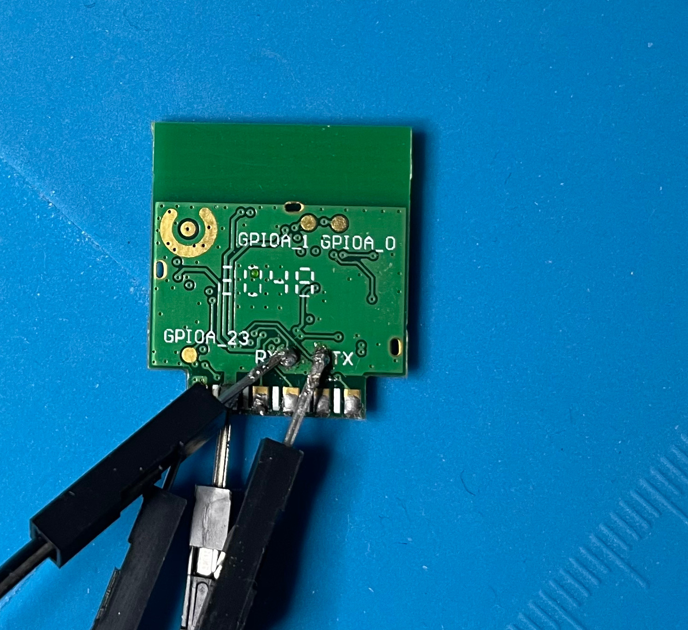

This post is part of a series; you are currently in **Part III**:

- [Part I: Recon](../meross-part-1)
- [Part II: Mobile App](../meross-part-2)
- [Part III: Smartplug](../meross-part-3) <-- **you are here**
- [Part IV: Firmware](../meross-part-4)
- [Part V: AmebaZII](../meross-part-5)
- [Part VI: Mi casa es su casa (finally)](../meross-part-6)
- [Part VII: Findings Collection](../meross-part-7)

---

After having a broad idea of how the backend operates, the next and most important
question is whether we can let the device operate with our own MQTT backend.

## Local API / Networking

First things first, in order to talk to the local device, we need to briefly look at
the local API (which is similar to the Cloud one). Again, I won't dive too deep into
the API and signature mechanism in detail here. What's important here is the know
that any device which is not yet *bound* to a user account yet uses an empty *shared*
*key*.

Consequently, any machine in the local network would be able to perform actions on
that device. Additionally, since all communication is in plain-text, any attacker
performing a man-in-the-middle attack can sniff the *shared key* or target Wifi
password. *No, this is not just a scenario, there are already two CVEs assigned to*
*this issue:* [CVE-2021-3774](https://nvd.nist.gov/vuln/detail/CVE-2021-3774) and [CVE-2023-46889](https://nvd.nist.gov/vuln/detail/CVE-2023-46889).

The API ues so-called "*scenes*", each of which targeting a different functionality of
the device. For instance, `System.Appliance.All` can be used to query device information:

```console
$ mrs device query 'System.Appliance.All' --host 10.13.37.2
{
  # device information here as JSON
  "system": {
    "firmware": # firmware version information
    "hardware": # chip info and version
    "online": # bind status
  }
}
```

To *bind* a Meross device to a user account, we can set the *shared key* received from the cloud, the target MQTT server the device will connect to and the target
wifi network. At first glance, it sounds like we can specify an arbitrary MQTT server
(our home broker) and let the device connect to it. Sure this won't work - they
must have some kind of server certificate validation, **right**?

---


### MQTT Broker integration

Integration with a local MQTT broker should not be that difficult **if** they forgot
to implement server certificate checking.

> For a more complete explanation of all options and additional configuration values
> for the MQTT broker, please visit [bytespider/Meross/wiki/MQTT](https://github.com/bytespider/Meross/wiki/MQTT).

The first step is to setup a certificate (self-signed) for the local MQTT broker. As
we assume there is no checking done at all, the *common name* can be anything.

```bash
# CA key and cert creation
openssl genrsa -out ca/ca.key 2048
openssl req \
  -new \
  -x509 \
  -days 1337 \
  -key ca/ca.key \
  -out ca/ca.crt \
  -subj "/CN=MQTT CA"

# broker certificate creation
openssl genrsa -out broker/broker.key 2048
openssl req \
  -new \
  -out broker/broker.csr \
  -key broker/broker.key \
  -subj "/CN=broker"
openssl x509 \
  -req \
  -in broker/broker.csr \
  -CA ca/ca.crt \
  -CAkey ca/ca.key
  -out broker.crt
```

Next, the server must accept anonymous client connections if you haven't confiured the password of the device account to be accepted by the broker.

```conf
tls_version tlsv1
allow_anonymous true
require_certificate false
use_identity_as_username false

listener 1883
listener 8883
# path to the generated certificates (and key)
cafile /etc/mosquitto/certs/ca/ca.crt
certfile /etc/mosquitto/certs/broker/broker.crt
keyfile /etc/mosquitto/certs/broker/broker.key
```
{: file="mosquitto.conf" }

After starting the server using the custom configuration we have to *bind* the device
to our user account. This can be done with one of the scripts provided in my tool
suite ([meross-scripts](https://github.com/MatrixEditor/meross-scripts)):

```shell
# 1. setup shared key and MQTT broker
mrs device bind --host 10.10.10.1 --mqtt-host 10.13.37.10:8883 --user-id '1234'
# 2. setup target wifi
mrs device bind --host 10.10.10.1 --wifi-ssid $WIFI_SSID --wifi-pass $WIFI_PASS
```

> Something I noticed during Wifi selection phase: Make sure the target Wifi **does not** use the same channel. The smartplug I used always selected channel `1`, which
> resulted in many failed attempts to bind, because the target Wifi netowrk also used
> channel `1`.
{: .prompt-info }

When the device connects to the Wifi and the broker, respectively, the MQTT output
may be similar to this:

```console
$ mosquitto_sub -h 127.0.0.1 -p 1883 -t '/appliance/#' -v
/appliance/XXXX/publish {"header":{"messageId":"XXXX","namespace":"Appliance.System.Clock","method":"PUSH","payloadVersion":1,"from":"/appliance/XXXX/publish","timestamp":12,"timestampMs":28,"sign":"XXXX"},"payload":{"clock":{"timestamp":12}}}
/appliance/XXXX/publish {"header":{"messageId":"XXXX","namespace":"Appliance.System.Report","method":"PUSH","payloadVersion":1,"from":"/appliance/XXXX/publish","timestamp":26,"timestampMs":147,"sign":"XXXX"},"payload":{"report":[{"type":"1","value":"1","timestamp":26}]}}
/appliance/XXXX/publish {"header":{"messageId":"XXXX","namespace":"Appliance.Control.Bind","method":"PUSH","payloadVersion":1,"from":"/appliance/XXXX/publish","timestamp":26,"timestampMs":178,"sign":"XXXX"},"payload":{"bind":{"bindTime":26,"time":{"timestamp":26,"timezone":"","timeRule":[]},"hardware":{"type":"mss210","subType":"us","version":"6.0.0","chipType":"rtl8710cf","uuid":"XXXX","macAddress":"aa:bb:cc:dd:ee:ff"},"firmware":{"version":"6.1.8","compileTime":"2020/07/03-11:01:20","wifiMac":"de:ad:be:ef:13:37","innerIp":"10.13.37.2","server":"10.13.37.10","port":8883,"userId":1}}}}
```

Talking security, this setup is prone to Main-in-the-Middle attacks, because an
attacker can simply host his own rogue MQTT broker and capture authentication
credentials in order to login to the real broker. I assume Meross either forgot
to add any kind of certificate validation or intentionally removed it to support
local integrations (which would've been very kind of them).

---

### Firmware Updates

Now that we've seen how a device *binds* itself to the user account using the MQTT
broker of Meross, it might be possible to do that manually and consequently request
firmware updates from Meross manually instead of relying on black-box updates.

The command below will first

1. Query the *local* device for hardware and firmware information
2. Connect to the cloud MQTT broker and publish a `Appliance.Control.Bind` request
3. Registers the device into the cloud account by sending its Uuid

```bash
# assuming 'mrs cloud auth login' was executed before
mrs cloud devices add \
  --device-ip '10.13.37.2' \
  --host 'iotx-ap.meross.com' \ # not needed
  --mqtt-domain 'iot.meross.com' \ # not needed
  --user-id '1234' \
  --uuid $DEVICE_UUID
```

After a device was successfully added to the account, we can query for new firmware
updates. The resulting lists will contain the download link that will be transferred
to the device, because there is no way for the device to **automatically** download new updates, at least for my MSS210 smartplug.

An example list of various firmware URLs is given below:
```console
$ mrs cloud devices list
┏━━━━━━━━━━━━━━━━━━━━━━━━━━━━━━━━━━┳━━━━━━━━━━━━━━┳━━━━━━━━━┳━━━━━━━━━━━━━━━━━━━━━━━━━━━━━━━━━━━━━━━━━━━━━━━━━━━━━━━━━━━━━━━━━━━━┳━━━━━━━━━━━━━━━━━━━━━━━━━━━━━━━━━━┓
┃ Uuid                             ┃ Type-SubType ┃ Version ┃ Url                                                                ┃ MD5                              ┃
┡━━━━━━━━━━━━━━━━━━━━━━━━━━━━━━━━━━╇━━━━━━━━━━━━━━╇━━━━━━━━━╇━━━━━━━━━━━━━━━━━━━━━━━━━━━━━━━━━━━━━━━━━━━━━━━━━━━━━━━━━━━━━━━━━━━━╇━━━━━━━━━━━━━━━━━━━━━━━━━━━━━━━━━━┩
│ xxxxxxxxxxxxxxxxxxxxxxxxxxxxxxxx │ MSS210-US    │ 6.2.3   │ http://static-file.meross.com/staticfile/1635133372731/7078520.bin │ 5c3640981ae2a00b569467bb1b5d0b66 │
└──────────────────────────────────┴──────────────┴─────────┴────────────────────────────────────────────────────────────────────┴──────────────────────────────────┘
```

Yes, I did not alter the URLs given above - **they are using HTTP**. By default, this shouldn't be an issue
since we can't modify the firmware. **However**, as you will read in one of the next parts, it **is** possible
to create custom firmware.

## Serial Console

Okay, so with the network related stuff done, the last open aspect was the hardware.You can see below there are some labelled UART test pads leading to a direct (custom) shell. The following image illustrates sample wiring to be able to access the UART interface.

{: .w-90 .rounded-10 w='740' h='480' .shadow .img-border }
*Wiring to access the UART interface. The leftmost pin is VCC and right next to it is GND*

Interacting with the serial console can be done with with [picocom](https://github.com/npat-efault/picocom). (Baud rate is `115200`)

```console
rpi@raspberrypi:~ $ picocom -b 115200 /dev/ttyUSB0
picocom v3.1
[...]
Type [C-a] [C-h] to see available commands
Terminal ready

== Rtl8710c IoT Platform ==
Chip VID: 5, Ver: 1
ROM Version: v2.1

== Boot Loader ==
Dec 16 2019:12:13:23

Boot Loader <==

== RAM Start ==
Build @ 09:44:13, Jun 10 2020

$8710c>
###############################
####  Meross Smart Things  ####
###############################

reset reason: 0
model: mss210
chip set: rtl8710cf
hw_ver: 6.0.0
fw_ver: 6.0.01.08
compiler: gcc 6.5.0
compile time: 2020/07/03-11:01:20
```

After some logging during device start we are eventually greeted with a shell
(seemingly a root shell). However, it quickly turned out to be a custom shell
implemented by Meross ([command examples](https://github.com/bytespider/Meross/blob/develop/teardown/README.md)).

The first message when the device boots up contains `"Rtl8710c IoT Platform"`, so I
quickly searched the web and found references to the Ameba AIoT platform together
with a publicly available [SDK on GitHub](https://github.com/Ameba-AIoT/ameba-rtos-z2). Now we can make an educated guess that the smartplug is running an RTOS instead of a full linux kernel.

Interestingly, there is a [Ameba AT-Commands documentation](https://github.com/Ameba-AIoT/ameba-rtos-z2/blob/main/doc/AN0075%20Realtek%20Ameba-all%20at%20command%20v2.0.pdf), which contains additional commands we can execute in the serial console. For instance, there are commands that are able to control the wifi settings(`ATWx`). These allow you to shut down an open wifi AP and create a new secured one with a passphrase. However, this new AP remains visible only while the device is online. Once it goes offline, the AP disappears.

```console
# ATWS
[ATWS]: _AT_WLAN_SCAN_

1	 Infra	 aa:bb:cc:dd:ee:ff -44	  11	   7	  WPA2 AES		  Wifi1
2	 Infra	 aa:bb:cc:dd:ee:ff -54	  6	   7	  WPA2 AES		  Wifi2
3	 Infra	 aa:bb:cc:dd:ee:ff -61	  9	   6	  WPA/WPA2 AES
4	 Infra	 aa:bb:cc:dd:ee:ff -66	  1	   7	  WPA2 AES		  Wifi3
5	 Infra	 aa:bb:cc:dd:ee:ff -75	  6	   6	  WPA/WPA2 AES
6	 Infra	 aa:bb:cc:dd:ee:ff -77	  6	   6	  WPA/WPA2 AES
```

While going through the publick SDK repository and the tools within, I found a flashing tool for new firmware called `"AmebaZII_PGTool"`. As this program turned out
to be written in C#, I quickly decompiled it to see if there were any other "undocumented" commands.

```bash
AmebaZII_PGTool/
AmebaZII_PGTool/bitbug_favicon.ico
AmebaZII_PGTool/favicon.ico
AmebaZII_PGTool/FirmwareDownloader.Properties
AmebaZII_PGTool/FirmwareDownloader.Properties/Resources.cs
AmebaZII_PGTool/FirmwareDownloader.Properties/Settings.cs
AmebaZII_PGTool/app.ico
AmebaZII_PGTool/Properties
AmebaZII_PGTool/Properties/AssemblyInfo.cs
AmebaZII_PGTool/AmebaZII_PGTool_v1.2.47.csproj
AmebaZII_PGTool/FirmwareDownloader
AmebaZII_PGTool/FirmwareDownloader/App.xaml
AmebaZII_PGTool/FirmwareDownloader/MainWindow.cs # <-- main code
AmebaZII_PGTool/FirmwareDownloader/ConsoleContent.cs
AmebaZII_PGTool/FirmwareDownloader/Form2.cs
AmebaZII_PGTool/FirmwareDownloader/MainWindow.xaml
AmebaZII_PGTool/FirmwareDownloader/App.cs
AmebaZII_PGTool/XModem
AmebaZII_PGTool/XModem/CRC16.cs
AmebaZII_PGTool/XModem/XModem.cs
```

A quick inspection of the source code (`MainWindow.cs` has just over 5000 lines - *very* quick look) took me to the `get_flash_id` function:

```csharp
private int[] flash_get_id()
{
  is_flash_type_unknown = false;
  string[] array = new string[4] { "EW 0x40020008 0\n", "EW 0x40020120 0\n", "EW 0x40020004 3\n", "EW 0x40020000 0x300\n" };
  string text = "EB 0x40020060 0x9F\n";
  string[] array2 = new string[3] { "EW 0x40020008 1\n", "DW 0x40020028\n", "EW 0x40020008 0\n" };
  string text2 = "DB 0x40020060\n";
  /* ... */
```

There seemed to be more commands, so I tested them out:

```console
# EW
 Command 'EW' unknown.
# DB
 Command 'DB' unknown.
```

What a bummer - so lets dig deeper. There is a function named `select_download_mode` (I didn't notice the name at that time), which brings the device into *download* mode by
**resetting** it if necessary.

```csharp
private int select_download_mode(bool is_cmd)
{
  read_data = "";
  // (1) Interesting, another command that can be tested...
  serialPort.Write("Rtk8710C\r\n");
  Thread.Sleep(50);
  read_data = serialPort.ReadExisting();
  /* ... */
  read_data = "";
  serialPort.Write("\r\n");
  Thread.Sleep(50);
  read_data = serialPort.ReadExisting();
  if (read_data.Contains("#"))
  {
    // (2) Another special command - UNDOCUMENTED??
    serialPort.Write("ATXX\r\n");
    Thread.Sleep(100);
    serialPort.DiscardInBuffer();
    serialPort.DiscardOutBuffer();
    read_data = "";
    serialPort.Write("Rtk8710C\r\n");
    /* ... */
}

```

There’s one command, however, that is not publicly documented. Searching for it
in the public SDK took me to the implementation:

```console
$ grep -r 'ATXX' ameba-rtos-z2/ -l
ameba-rtos-z2/component/common/api/at_cmd/atcmd_sys.c
```

Inside the source code there are the definitions we were looking for (`ameba-rtos-z2/component/common/api/at_cmd/atcmd_sys.c`). Interestingly enough, the command is
only available on RTL8720C SOCs:

```c
log_item_t at_sys_items[] = {
#ifndef CONFIG_INIC_NO_FLASH
#if ATCMD_VER == ATVER_1
#if defined(CONFIG_PLATFORM_8710C)
	{"ATXX", fATXX, {NULL, NULL}}, // <-- undocumented command
#endif
// [...]
#if CONFIG_OTA_UPDATE
	{"ATSC", fATSC,},	// Clear OTA signature
	{"ATSR", fATSR,},	// Recover OTA signature
```


The command itself is quite simple, but its impact is like a doomsday for the device. The C code that controls it looks like this:

```c
void fATXX(void *arg)
{
#if defined(CONFIG_BUILD_NONSECURE) && (CONFIG_BUILD_NONSECURE==1)
	flash_t flash_Ptable;
	device_mutex_lock(RT_DEV_LOCK_FLASH);
	flash_erase_sector(&flash_Ptable, 0x00000000);
	device_mutex_unlock(RT_DEV_LOCK_FLASH);
	sys_reset();
#else
	u8 download_mode = 0;
	if (arg) {
		download_mode = (unsigned char) atoi((const char *)arg);
	}
	sys_download_mode(download_mode);
#endif
}
#endif
```

What happens here is that it *deletes the first sector of the flash*. This sounds pretty harmless, right? **WRONG**. That first sector happens to contain the partition table and some flash calibration data. Without this data, the device becomes unusable.

Of course I ran it *without* looking at the source code first to know what it does:
```console
# ATXX
<device reboots here>

== Rtl8710c IoT Platform ==
Chip VID: 5, Ver: 1
ROM Version: v2.1
[BOOT Err] Parttition Table Header(Plain Text) Verification Err!
StartUp@0x0: Invalid RAM Img Signature!

$8710c>
```

At this point, the device enters a fallback mode, and the absence of the partition table makes it inoperable. The partition table is used by the ROM bootloader to load the RAM bootloader, so without it, the device cannot proceed.

### Fallback CLI Commands

The fallback CLI provides several powerful commands that allow for direct interaction with the device at a low level. Below is a list of the available commands you can try, with `?` or `help` to view the full set.

```
DB
	DB <Address, Hex> <Len, Dec>:
	Dump memory byte or Read Hw byte register

DHW
	DHW <Address, Hex> <Len, Dec>:
	Dump memory helf-word or Read Hw helf-word register;

DW
	DW <Address, Hex> <Len, Dec>:
	Dump memory word or Read Hw word register;

EB
	EB <Address, Hex> <Value, Hex>:
	Write memory byte or Write Hw byte register
	Supports multiple byte writting by a single command
	Ex: EB Address Value0 Value1

EW
	EW <Address, Hex> <Value, Hex>:
	Write memory word or Write Hw word register
	Supports multiple word writting by a single command
	Ex: EW Address Value0 Value1

WDTRST (reboot)
	WDTRST
	To trigger a reset by WDT timeout
```

For example, the `DB` command allows you to read bytes from an **arbitrary** memory location
within the chip. This includes not just the flash memory but the entire chip memory, as
outlined in the device’s documentation.

---


### Download Mode CLI

If you enter download mode, following the guide by [ltchiptool](https://github.com/libretiny-eu/ltchiptool),
you’ll gain access to additional commands. These commands provide various functionalities for
interacting with the device. Here’s a list of the commands identified so far:

```
ping
    Ping back

uboot
    (Command unclear – documentation needed)

fwdram
    Firmware download (RAM)

disc
    Disconnect and reboot

seras
    (Same as in fallback mode)

ceras
    (Same as in fallback mode)

hashq
    Calculate hash (refer to ltchiptool documentation)

hashs
    (Refer to ltchiptool documentation)

otu2x
    otu2x <flash_io> <flash_pin>
    (Function unclear – documentation needed)

otu2
    otu2 <flash_io> <flash_pin> <fw_idx>
    (Function unclear – documentation needed)

otu1
    otu1 <flash_io> <flash_pin>

fwd
    Firmware download (Flash)

ucfg
    UART configuration

efotp
    Internal Cmd.
```

---

#### The `efotp` command

There is one special command that is not part of the flashing tool provided by
Ameba but present within the bootloader: `efotp`. After having a quick look at
the ROM code, this command seems to be related to the secure efuse region of
the chip.

```c

uint test_mode_efotp_cmd(int argc,char **argv)

{
  byte value;
  uint arguments [3];

  if (4 < argc) {
    argc = 5;
  }
  value = 0xff;
  /* copy argv into arguments (snipped) */
  if (arguments[0] != 0) {
    if (arguments[0] == 1) {
      hal_efuse_read(arguments[1],(uint16_t)arguments[2],&value);
      if (*(int *)PTR_DAT_00000b80 << 0x1f < 0) {
        printf("read 0x%x = 0x%x\r\n",arguments[2],value);
        return 0;
      }
    }
    return 0;
  }
  /* -- snip -- */
  return 0;
}
```

This command may enable direct access to the efuse when entering the download mode. However, this command wasn't tested and verified.

### Recap

To recap what happend so far:
* I accessed a serial console over UART without being prompted to authenticate,
* found some undocumented commands to reset the device and
* accidentially *bricked* the device by executing an undocumented command.

Since the device is now in a bricked state, the next post will focus on reverse
engineering the firmware file (*which was challenging at first*). Re-creating
the partition table in theory will be discussed as well.

> Here you can move to the next part of this series [Part IV: Firmware](../meross-part-4).