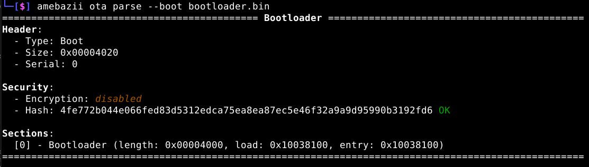
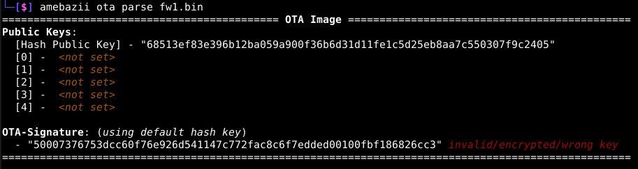
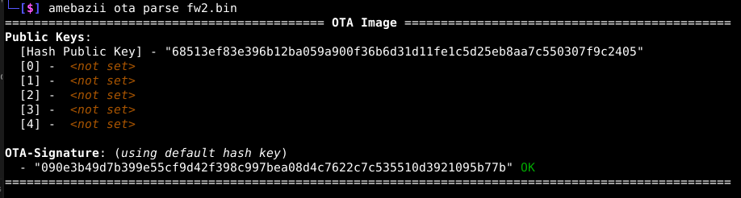
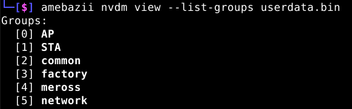
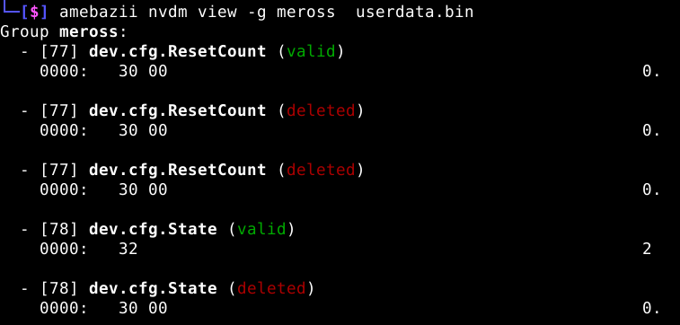
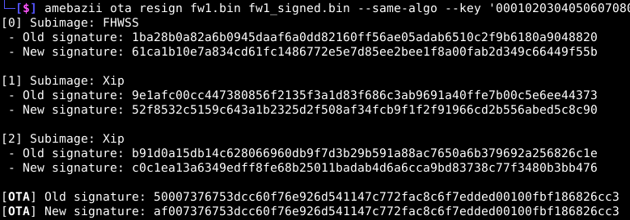
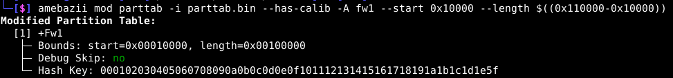
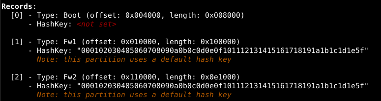

This post is part of a series; you are currently in **Part V**:

- [Part I: Recon](../meross-part-1)
- [Part II: Mobile App](../meross-part-2)
- [Part III: Smartplug](../meross-part-3)
- [Part IV: Firmware](../meross-part-4)
- [Part V: AmebaZII](../meross-part-5) <-- **you are here**
- [Part VI: Mi casa es su casa (finally)](../meross-part-6)
- [Part VII: Findings Collection](../meross-part-6)

---

After reversing the firmware I had vulnerabilities but no functional device to test on reliably and there was still the issue with the erased partition table.

In this post I *try* to explain how a device can be *un-bricked* using my [amebazii]() tool and the current state. You can skip to the next part if you want to see some hacking action.


<!-- map: repos/ameba-rtos-z2/component/soc/realtek/8710c/misc/iar_utility/8710c.ddf
https://github.com/Ameba-AIoT/ameba-rtos-z2/blob/main/component/soc/realtek/8710c/misc/iar_utility/8710c.ddf -->

## New Firmware

So first, I needed the complete flash image to see what I have to work with for the next
time. Using the almighty [ltchiptool](https://github.com/libretiny-eu/ltchiptool), pulling the flash from the device wasn't that difficult (it even has a very nice manual for the target chip).

After extracting the flash we get:

```console
$ xxd flash.bin | head
00000000: ffff ffff ffff ffff ffff ffff ffff ffff  ................
00000010: ffff ffff ffff ffff ffff ffff ffff ffff  ................
00000020: ffff ffff ffff ffff ffff ffff ffff ffff  ................
00000030: ffff ffff ffff ffff ffff ffff ffff ffff  ................
00000040: ffff ffff ffff ffff ffff ffff ffff ffff  ................
00000050: ffff ffff ffff ffff ffff ffff ffff ffff  ................
00000060: ffff ffff ffff ffff ffff ffff ffff ffff  ................
00000070: ffff ffff ffff ffff ffff ffff ffff ffff  ................
00000080: ffff ffff ffff ffff ffff ffff ffff ffff  ................
00000090: ffff ffff ffff ffff ffff ffff ffff ffff  ................
```

The start of the flash image is the erased partition table, so nothing to see here...

### Partitions

The partitions can be extracted using the application note which specifices the *almost* exact location and sizes of the target sections.

```console
$ dd if=flash.bin of=test/bootloader.bin bs=1 skip=16384 count=49152
$ dd if=flash.bin of=test/userdata.bin bs=1 skip=2031616
...
$ dd if=flash.bin of=test/fw2.bin bs=1 ibs=1 obs=1 skip=1114112 count=917504
```

The complete flash layout is given below (created with [asciiflow](https://asciiflow.com/)):
```
Section 5.2 - Layout
┌──────────────────┐
│ Partition Table  │ 0x00000020 - 0x00001000
├──────────────────┤
│ System Data      │ 0x00001000 - 0x00002000
├──────────────────┤
│ Calibration Data │ 0x00002000 - 0x00003000
├──────────────────┤
│ Reserved         │ 0x00003000 - 0x00004000
├──────────────────┤
│                  │
│ Boot Image       │ 0x00004000 - 0x0000C000
│                  │
├──────────────────┤
│                  │
│                  │
│ Firmware 1       │ 0x10000
│                  │
│                  │
├──────────────────┤
│                  │
│                  │
│ Firmware 2       │
│                  │
│                  │
├──────────────────┤
│                  │
│ User Data        │
│                  │
└──────────────────┘
```

We can copy out the bootloader first:
```console
$ dd if=flash.bin of=bootloader.bin bs=1 skip=$((0x4000)) count=$((0xC000-0x4000))
```

The boot image is actually a parseable OTA-like image and can be inspected with the `ota parse` command:
```bash
# parse boot image
amebazii ota parse --boot bootloader.bin
```

{: .w-90 .rounded-10 w='750' h='740' .shadow .img-border }
*amebazii CLI tool to parse/inspect the bootloader image*

Now we simply extract the firmware images one and two. The first begins at `0x10000` and
the second at `0x110000`. Unfortunately, the user data region is placed at a dynamic offset, which is somewhat annoying. Luckily, Meross uses a storage format named NVDM, which uses the `NVDM` header marker at the start of the user data section. So, we can simply infer the start of the user section
```console
$ xxd flash.bin | grep NVDM
0004b020: 0120 7047 4e56 444d 00b5 0b4b 83b0 1b68  . pGNVDM...K...h
0004b050: 61fe 03b0 5df8 04fb f8b4 0110 4e56 444d  a...].......NVDM
--- snip ---
001f0000: 4e56 444d 0200 0000 feff 01ff ffff ffff  NVDM............ <-- start of user-data
001f1000: 4e56 444d 0200 0000 feff 01ff ffff ffff  NVDM............
001f2000: 4e56 444d 0000 0000 e0f0 01ff f802 ff00  NVDM............
001f3000: 4e56 444d 0200 0000 feff 01ff ffff ffff  NVDM............
001f4000: 4e56 444d 0200 0000 feff 01ff ffff ffff  NVDM............
001f5000: 4e56 444d 0100 0000 e0f0 01ff f805 ff00  NVDM............
```

Other partiions can be extracted manually with `dd' as well:
```console
$ dd if=flash.bin of=fw1.bin bs=1 skip=$((0x10000)) count=$((0x110000-0x10000))
$ dd if=flash.bin of=fw2.bin bs=1 skip=$((0x110000)) count=$((0x1f1000-0x110000))
$ dd if=flash.bin of=userdata.bin bs=1 skip=$((0x1f1000))
```

Interestinly, parsing the first firmware image of the flash showed an invalid singing key error when using the default hash key. Since we know Meross is using the default hash key this image is most likely corrupted.

{: .w-90 .rounded-10 w='750' h='740' .shadow .img-border }
*Invalid signing key for the first firmware image*

The second extracted OTA image succeeds:

{: .w-90 .rounded-10 w='750' h='740' .shadow .img-border }
*No error when parsing the second firmware image*

If you dig into the format of `userdata.bin`, you will ultimately (after using some strong googling skills) find the the NDVM data format ([nvdm.h](https://github.com/hermeszhang/linkit_sdk_public/blob/master/middleware/MTK/nvdm/inc/nvdm.h)) and source code here: [demoMT](https://github.com/dangkhoalk95/demoMT).

#### NVDM

NVDM is a binary storage format for configuration variables. There are groups and
configuration entries with values attached.

{: .w-90 .rounded-10 w='750' h='740' .shadow .img-border }
*All groups of Meross' NVDM data*

Unfortunately, the format does not define which data type is used in each entry. It is left to the user to use the correct function to return the correct representation.

{: .w-90 .rounded-10 w='750' h='740' .shadow .img-border }
*Example of Meross' NVDM data*


### Building a new Partition Table

Now that we have all partitions from the flash image, we can generate the new Partition Table. For more information about all structures related to the partition table, please refer to the [pt.rs](https://github.com/MatrixEditor/amebaz2/blob/master/src/amebazii/types/image/pt.rs) implementaion.
```console
$ ls -la *.bin
-rw-rw-r--   32768 bootloader.bin
-rwxr-x--- 2097152 flash.bin
-rw-rw-r-- 1048576 fw1.bin
-rw-rw-r--  921600 fw2.bin
-rw-rw-r--   61440 userdata.bin
```

Now we can generate a new partition table using a single boot entry pointing to the bootloader partition:

```console
$ amebazii build parttab --config parttab.json parttab.bin
$ amebazii flash parse --pt-only parttab.bin
===================================== Partition Table =====================================
Public Keys:
  [0] - "ffffffffffffffffffffffffffffffffffffffffffffffffffffffffffffffff"
  [1] - "ffffffffffffffffffffffffffffffffffffffffffffffffffffffffffffffff"

Signature: (using default hash key)
  - "f233531b2af53eebd450fa759f070e97a6b4103307cd53c9cf92653a3ca65bda" OK

User Data:
  - UserExt: "ffffffffffffffffffffffff"
  - UserBin: <not set>
  - Fw1 Index: 0
  - Fw2 Index: 0

Records:
  [0] - Type: Boot (offset: 0x004000, length: 0x008000)
      - HashKey: <not set>

===========================================================================================
```

Next, we need to add all firmware images and the existing user-data to the partition table:

1. **fw1:** For the (corrupted) first firmware image:
  As the signature is invalid as seen above, we need to "resign" the image using
  the default hash key:
  {: .w-90 .rounded-10 w='750' h='740' .shadow .img-border }
*Resinging the first OTA image to use the correct signature.*
  Then we can use the `mod' command to add a new partition record:
  ```console
$ amebazii mod parttab -i parttab.bin --has-calib -A fw1 \
    --start 0x10000 \
    --length $((0x110000-0x10000)) \
    --hash-key '000102030405060708090a0b0c0d0e0f101112131415161718191a1b1c1d1e5f'
Modified Partition Table:
  [1] +Fw1
  ├─ Bounds: start=0x00010000, length=0x00100000
  ├─ Debug Skip: no
  └─ Hash Key: 000102030405060708090a0b0c0d0e0f101112131415161718191a1b1c1d1e5f
  ```
  {: .w-90 .rounded-10 w='750' h='740' .shadow .img-border }
*Adding the first firmware image to the partition table*

2. **fw2:** important no `--has-calib` (removed from previous command)
  ```console
$ amebazii mod parttab -i parttab.bin -A fw2 \
    --start 0x110000 \
    --length $((0x1f1000-0x110000)) \
    --hash-key '000102030405060708090a0b0c0d0e0f101112131415161718191a1b1c1d1e5f'
Modified Partition Table:
  [2] +Fw2
  ├─ Bounds: start=0x00110000, length=0x000e1000
  ├─ Debug Skip: no
  └─ Hash Key: 000102030405060708090a0b0c0d0e0f101112131415161718191a1b1c1d1e5f
  ```

Next, to add userdata we need the section's size in bytes.
```console
$ du -b userdata.bin
61440	userdata.bin
```

```console
$ amebazii mod parttab -i parttab.bin -A user --start $((0x1f1000)) --length 61440
Modified Partition Table:
  [3] +User
   ├─ Bounds: start=0x001f1000, length=0x0000f000
   ├─ Debug Skip: no
```

Additionally, the flash contains some system related data (this section also contains the active firmware index). This secion needs to be added as well
Finally, add sysdata:
```console
amebazii mod parttab -i parttab.bin -A sys \
  --start $((0x1000)) \
  --length $((0x2000-0x1000))
Modified Partition Table:
  [4] +Sys
   ├─ Bounds: start=0x00001000, length=0x00001000
   ├─ Debug Skip: no
```

Finally, we need to set the correct firmware index for each of the added firmware entries, so they can be referenced from the RAM bootloader correctly:
```console
$ amebazii mod parttab -i parttab.bin --set-fw1 1 --set-fw2 2
Modified Partition Table:
  - FW1 Index: 0 -> 1
  - FW2 Index: 0 -> 2
```

{: .w-90 .rounded-10 w='750' h='740' .shadow .img-border }
*Example of Meross' NVDM data*

### Build new flash image

With the partition tavle built and having all sections at hand, we can simply concatenate them to the flash image:
```console
$ amebazii flash combine --parttab parttab.bin flash_patched.bin \
    --fw1 fw1_signed.bin \
    --fw2 fw2.bin \
    --system sysdata.bin \
    --user userdata.bin \
    --boot bootloader.bin
[Sys] => Status: Ok
[Fw1] => Status: Ok
[Fw2] => Status: Ok
[User] => Status: Ok
[Boot] => Status: Ok
```

Partition table and flash canthen  be parsed again and should display the correct result:
```console
$ amebazii flash parse flash_patched.bin                                                                                                                                    [14:31:29]
****************************************** Flash ******************************************
Calibration Pattern:
  - "999996963fcc66fcc033cc03e5dc3162"

===================================== Partition Table =====================================
Public Keys:
  [0] - "ffffffffffffffffffffffffffffffffffffffffffffffffffffffffffffffff"
  [1] - "ffffffffffffffffffffffffffffffffffffffffffffffffffffffffffffffff"

Signature: (using default hash key)
  - "7bdb9008c5cd1101b758cdbee16b30814417dd84960d81afc5815908e30a3fc6" OK

```

The size of both flash files (must)/will be identical:
```console
$ du -b flash*
2097152	flash.bin
2097152	flash_patched.bin
```


## Current status

Yes I know, having that much of a prologue and then saying I haven't had the time to
flash the new firmware is a lazy excuse. This post merely documents what is needed to build a new flash image. So if you ever stumble across the `ATXX` command and you have bricked your device, use this post the hopefully *un-brick* it.

For reference, you can use the following
commands to flash the new flash image. Everything else should work after that.
Using ltchiptool we can write the contents fairly easy:
```console
$ ltchiptool flash write --length 640 --start 0x98000000 parttab.bin
$ ltchiptool flash write --length 657284 --start 0x98010000 parttab.bin
```

Having said that, the next posts will continue the journey out of the rabbit hole and show some pretty neat flaws (partially fixed) in Meross' IoT architecture.

> Props on reading until the end; you can move to the next part of this series here: [Part VI: mi casa es su casa](../meross-part-6).
