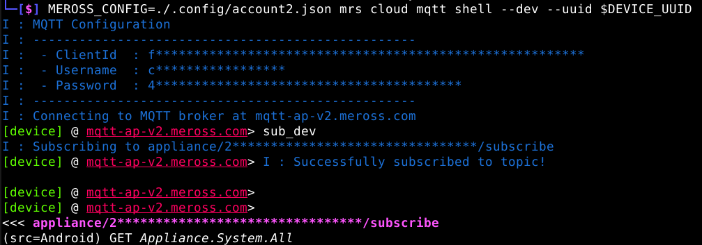
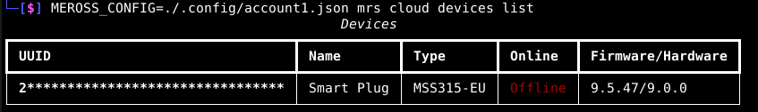
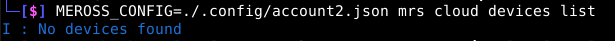
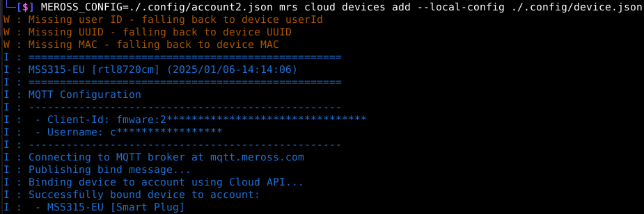
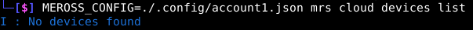

This post is part of a series; you are currently in **Part III**:

- [Part I: Recon](../meross-part-1)
- [Part II: Mobile App](../meross-part-2)
- [Part III: Smartplug](../meross-part-3)
- [Part IV: Firmware](../meross-part-4)
- [Part V: AmebaZII](../meross-part-5)
- [Part VI: Mi casa es su casa (finally)](../meross-part-6) <-- **you are here, almost finished**
- [Part VII: Findings Collection](../meross-part-7)

---

To get out of the rabbit hole, lets focus on the cloud backend for a while. In the end,
we will be able to transfer ownership of an already registered device remotely, enabling
a direct communication channel. Using a technique from [Part VII: Findings Collection](../meross-part-6), it is possible to send messages to these devices too.

But before that, lets discuss the device UUID for a bit (I had a long discussion with Meross about those; and intereseingly, I seem to have more knowledge than them on the structure).

## Eve Devices
Have you ever wondered about the structure of the UUID of each device? In [Part II: Mobile App](../meross-part-2) I've listed some example UUIDs extracted from a JSON file
of the mobile application (*fixed by Meross after disclosure*).

```python
"mss426s_uuids": [
  "1807114624231901234534298f1f0e8e",
  "1808172927483429083434298f16289d",
  "1808174524147329083434298f16289e",
  "1808173410854129083434298f16289f",
  "1808171063540829083434298f1628a0",
  "1808178987020229083434298f1628a1",
  "1808172190307929083434298f1628a2",
  "1808179547479729083434298f1628a3",
  # ...
"mss426f_macs": [
  "34298F1626FA",
  "34298F162421",
  "34298F1623C4",
  "34298F162882",
  "34298F16239F",
```

There is a common part:
```
UUID : 18071146242319012345 34298f1f0e8e
MAC  :                      34298F1626FA
```

That means if we know the UUID we also know the MAC address of a device. Additionally, I was able to pin some other numbers in the UUID to the following structure:

```text
uuid := Y || M || D || RND || BATCH || MAC
Y     – manufacturing year (two digits)
M     – manufacturing month (two digits)
D     – manufacturing day (two digits)
RND   – random value (8 digits)
BATCH – batch number (fixed across a number of UUIDs)
MAC   – device’s MAC address
```
{: file="device UUID structure" }

That means the *"random"* part of the UUID is reduced to 8 digits (decimals only, not hex) - so a four byte number alongside a batch number fixed across multiple UUIDs. This detail is crucial here, and somehow Meross didn't know about it.

> [Meross]\: "[...] The UUID's random code consists of 8 bytes, which we consider to provide sufficient randomness.[...]"
>
> However, the UUIDs I observed use an 8‑digit random number for **RND**. This limits the maximum value to 100,000,000, which reduces the number of attempts an attacker would need to guess
the next UUID. With a single request per second, an attacker would need approximately 1,157 days to exhaust the worst‑case scenario. If the attacker can perform 20 checks per second, the worst‑case time drops to roughly 58 days.
>
> the *worst case* here includes **all** possible combinations.
{: .prompt-info }

All of that is important, because nothing else is required to authenticate
against the MQTT backend **as the device itself**. So, consider the following scenario:

1. **Account 1:** victim account with a device bound to it
2. **Account 2:** attacker account that only knows the device's UUID

Assuming the victim issues a command to the device via the mobile app, an attacker that uses the login as the same device using the UUID can simly eavesdrop on all messages sent from the victim:

{: .w-90 .rounded-10 w='550' h='740' .shadow .img-border }
*Captured message*

This effectively enables eavesdropping of unencrypted messages sent to the device from the cloud. In  [Part VII: Findings Collection](../meross-part-7) it will be shown that messages can be replayed. However, for the replay over the cloud MQTT to work, the device must be bound to our attacker account.

## Rogue Device Registration

In [Part III: Smartplug](../meross-part-3) I've explained the process of how a device is
bound to an account and which details are sent to the backend. I also showed a way to perform this process manually using the details of a device.

Consider a device already bound to **account1** and a second user **account2** that does not have devices bound to their account.

{: .w-90 .rounded-10 w='550' h='740' .shadow .img-border }
*Devices bound to acctount1*

{: .w-90 .rounded-10 w='550' h='740' .shadow .img-border }
*Devices bound to acctount2*

If we now attempt to bind the same device, an error is returned:

```console
$ MEROSS_CONFIG=./.config/account1.json mrs cloud devices add --local-config device_info.json
W : Missing user ID - falling back to device userId
W : Missing UUID - falling back to device UUID
W : Missing MAC - falling back to device MAC
I : ==================================================
I : MSS315-US [rtl8720cm] (2025/01/06-14:14:06)
I : ==================================================
I : MQTT Configuration
I : --------------------------------------------------
I :  - Client-Id: b'fmware:XXXX
I :  - Username: XXXX
I : --------------------------------------------------
I : Connecting to MQTT broker at mqtt.meross.com
I : Publishing bind message...
E : Failed to bind device: apiStatus=20106 sysStatus=0 info='Resource does not exist'
```

This behavior is intended - the same device should not be registered with the same account or another account twice. *However*, what happens if we change the MAC address
of the device in the JSON config?

{: .w-90 .rounded-10 w='550' h='740' .shadow .img-border }

**IT WORKS!** And not only that, the device is now *bound* to **account2** without any
notice:

{: .w-90 .rounded-10 w='550' h='740' .shadow .img-border }
*Devices bound to acctount1 after transition*

{: .w-90 .rounded-10 w='550' h='740' .shadow .img-border }
*Devices bound to acctount2 after transition*

Okay great, but why is this useful other than disrupting another user's device list?

> *When a device is bound to your account, you are allowed to send messages to that d
device via the MQTT broker.*

In result, with a previously captured message using the technique from above, we can replay a message and trigger an action on the device **OR** on unpatched devices abuse the stack-based buffer overflow to execute arbitrary code on the target device remotely.

> This issue has been fixed shortly after Meross acknowledged the bug.
{: .prompt-info }

### Result

In essence, these two bugs alongside the findings of the previous posts can be chained to

1. Find out a target UUID (google them, there are plenty)
2. Listen in using the MQTT broker to capture a valid message with a valid signature
3. Once captured, transfer ownership of the device to your own account
4. Replay the captured message or exploit the buffer overflow to get code execution

So, this enabled owning IoT devices of Meross remotely without another user knowing. Fortunately, Meross did address these findings promptly and acted shortly after receiving the reports. **The discussed vulnerabilities/bugs here are no longer valid**.


> Here you can move to the next part of this series [Part VII: Findings Collection](../meross-part-7).